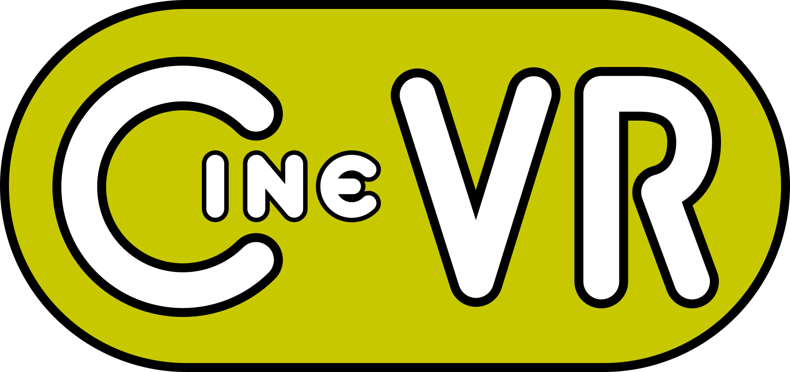

<!--
SPDX-FileCopyrightText: 2025, 2026 QuantumHole <QuantumHole@github.com>

SPDX-License-Identifier: GPL-3.0-or-later
-->

# 
Cine-VR displays media in 3D using OpenVR and OpenGL.

It renders a media file into HMD stereoscopically.
It also shows the left eye view in a companion window on the desktop.
It demonstrates handling of a menu structure.
To achieve this, the most basic graphical elements for user interactions had to be implemented from scratch.
These elements contain simple and toggle buttons, slideable gauges as well as scrollable text boxes.
Users can configure some display options via the OpenVR controller.

# Dependencies

## Runtime Dependencies
* [OpenGL](https://www.opengl.org)
* [GLFW](https://www.glfw.org) 3.4 or newer, built with Wayland support for native sway sessions
* [OpenVR](https://github.com/ValveSoftware/openvr)
* [libpng](https://www.libpng.org/pub/png/libpng.html)
* [libjpeg](https://jpegclub.org/reference/reference-sources)
* [FreeType2](https://freetype.org/index.html)
* [libmpv](https://mpv.io)

## Build Dependencies

* [gcc](https://gcc.gnu.org) or [clang](https://clang.llvm.org)
* [GNU make](https://www.gnu.org/software/make)
* [pkg-config](https://www.freedesktop.org/wiki/Software/pkg-config)
* [SDL3](https://wiki.libsdl.org/SDL3/FrontPage)

## Lint Dependencies

* [uncrustify](https://github.com/uncrustify/uncrustify)
* [reuse](https://reuse.software)

# Building

`make run`

## Wayland

In a Wayland session, Cine-VR requests GLFW's native Wayland backend by default. GLFW must be built with Wayland support. To choose a backend explicitly, set `CINE_VR_PLATFORM` to `wayland`, `x11`, or `auto`:

```sh
CINE_VR_PLATFORM=wayland ./cine-vr
CINE_VR_PLATFORM=x11 ./cine-vr
```

`x11` uses XWayland when launched from sway. `auto` lets GLFW select an available platform. The selected GLFW platform is printed at startup. Native window support does not guarantee that the installed SteamVR/OpenVR runtime supports running its compositor in the same Wayland session; that must be verified separately.

# Contribution

Before committing, please take care of source code format and proper license information.

`make lint`

# Background Information

Some useful resources for learning the topics covered in this project.
* OpenGL Video tutorials by [Victor Gordan](https://www.youtube.com/@VictorGordan/videos)
